# GitHub Contribution Garden 🌱

Turn your GitHub contribution graph into a living, animated garden.

Each day becomes a small plot. Contributions grow from bare soil into leaves and flowers, while a gardener walks between the plants and bees visit the blooms.

## Preview

### Light theme


### Dark theme



*The previews use deterministic sample data. Your garden uses your real GitHub contribution calendar.*

## Highlights

- One plot for every contribution day.
- `0` contributions: soil, `1`: one leaf, `2`: two leaves, `3+`: a flower.
- Flower colors change as the daily contribution count increases.
- Gentle wind, occasional stronger gusts, a walking gardener, and two flower-visiting bees.
- Separate light and dark SVGs with reduced-motion support.
- Automatic daily updates through GitHub Actions.
- No npm dependencies, build step, JavaScript, or external images inside the generated SVGs.

## Add It to Your Profile

Create `.github/workflows/garden.yml` in your profile repository:

```yaml
name: Grow Contribution Garden

on:
  schedule:
    - cron: '17 0 * * *'
  workflow_dispatch:

permissions:
  contents: write

concurrency:
  group: contribution-garden
  cancel-in-progress: false

jobs:
  grow:
    runs-on: ubuntu-latest
    steps:
      - name: Generate garden
        uses: kgnio/github-contribution-garden@v1.0.0
        with:
          github_user_name: ${{ github.repository_owner }}
          github_token: ${{ secrets.GITHUB_TOKEN }}

      - name: Publish garden
        uses: crazy-max/ghaction-github-pages@v3.1.0
        with:
          target_branch: output
          build_dir: dist
          keep_history: true
        env:
          GITHUB_TOKEN: ${{ secrets.GITHUB_TOKEN }}
```

Run it once from **Actions → Grow Contribution Garden → Run workflow**.

Then add this to your profile README and replace `YOUR_USERNAME`:

```html
## 🌱 Contribution Garden

<picture>
  <source media="(prefers-color-scheme: dark)" srcset="https://raw.githubusercontent.com/YOUR_USERNAME/YOUR_USERNAME/output/contribution-garden-dark.svg" />
  
</picture>
```

The workflow generates:

- `contribution-garden.svg`
- `contribution-garden-dark.svg`

The automatic `GITHUB_TOKEN` is enough for public contribution data. Private contribution visibility depends on your GitHub profile and token permissions.

## Action Inputs

| Input | Default | Description |
| --- | --- | --- |
| `github_user_name` | Required | GitHub username to visualize. |
| `github_token` | Workflow token | Token used to read contribution data. |
| `output_dir` | `dist` | Directory for the generated SVG files. |

## Run Locally

Requires Node.js 24 or newer.

```sh
npm run demo
npm test
```

To generate a garden with real contribution data:

```sh
GITHUB_TOKEN=your_token npm run generate -- --user YOUR_USERNAME
```

## Contributing

Issues and pull requests are welcome. Keep code and user-facing text in English, and run `npm test` before submitting changes.

## License

[MIT](LICENSE) · Created by [kgnio](https://github.com/kgnio)
